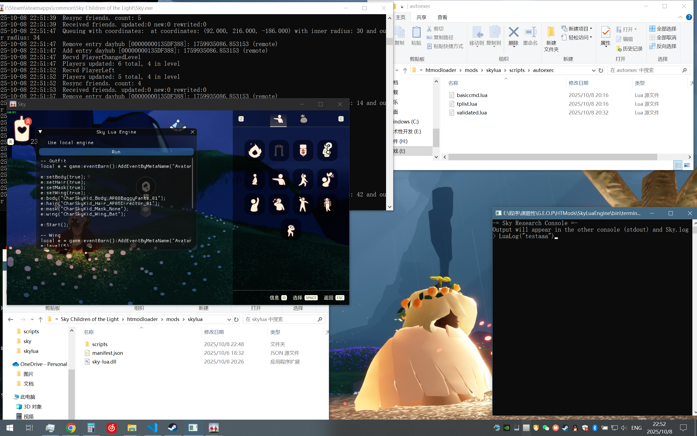

# Sky: COTL Research Tool

A simple C++ program that lets you load Lua scripts into "Sky: Children of the Light" (desktop version) through a named pipe while it's running, or execute scripts when the game is initialized. The scripts run in the game's built-in Lua engine.

The mod includes an in-game editor and REPL (see below). The files in `control/` are optional external tools that can still be used to send scripts or enter Lua code through a named pipe.

The source of the mod is in `src/`.

[HTModLoader](https://www.github.com/HTMonkeyG/HTML-Sky) have to be installed before using this mod. View its documentation for installation.

You need to put the compiled `sky-lua.dll` and `manifest.json` in a single folder to register the mod, then start the game as normal. When the game is fully initialized, press `F8` to show the in-game ImGui menu. Press `F9` to execute the active script. Put scripts in `scripts/autoexec` under the mod folder to evaluate them when the game has started.

The in-game menu contains two tabs:

* **Editor** - a file browser for the `scripts` folder plus a multi-file editor. Scripts can be created, opened, edited and saved back into `scripts` (subfolders are supported). Unsaved tabs are marked with `*`, and `Ctrl+S` / `Ctrl+N` save the active tab or create a new one. Press `Esc` while the editor has keyboard focus to release it.
* **REPL** - a Lua console running against the game's Lua state. Every line is evaluated as an expression first, then as a statement block, and the results, errors and `print()` / `sle.log()` output are shown in the REPL terminal instead of the HTModLoader console. Use the up/down arrow keys to browse the command history.

When the mod initializes the game's Lua state, it registers `_G.sle = {}` with the following helpers:

* `sle.log(...)` / `sle.print(...)` - print to the REPL terminal while a REPL snippet is running, otherwise print to the HTModLoader console.

The mod itself contains a independent Lua engine (v5.2.0, the same version with the one in-game), enable `Use local engine` to interpret scripts with it. Note that the local engine has some issues when using `print()` function which the game defined. Use `LuaLog` instead.

The mod can be loaded on both Chinese and international editions. However, since the Chinese edition of the game requires administrator privileges, the external executable files also need to be started with administrator privileges.

## Building

Execute `mingw32-make all` to compile third-party libraries included in the repository during the first compilation. After that you can execute `mingw32-make` directly.

The files in `control\` are additional executable files that provide cross process operations. You can compile them using any compilers.

## Updating

If it breaks, two signature codes in `src\sigcodes.h` need to be updated. `Lua::debugDoString` is the debug function built into the game that loads code from a Lua source string. `Client::checkChangeLevel` is nonspecific, it's just a function that runs in the game's main loop and receives a Lua state pointer - it can be replaced with any other similar function (the criteria being that it gets a Lua state and runs in the game's main update thread).

The main update thread thing is important because Lua is single-threaded, so `Lua::debugDoString` or other operations with local Lua engine has to be called from within the game's main thread. If you tried calling it directly, it would cause occasional crashes.
